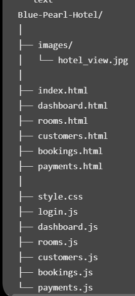

# Blue Pearl Hotel Management System

**link**:https://mercymumbe.github.io/hotel_management_system/

## Project overview
This is a system designed to help hotel admnistratorsmanage daily operation systems.it provides easy way to manage hotel rooms customers, bookings and payments across the hotel

## Objectives
- Provide an organised dashboard
- Simplfy Hotel Management operations
- Manage Hotel room records
- Register new customer and manage customer informations
- Record and manage hotel bookings
- Track payments.

## Features

### Admin Login and Registration
- Allows administrators to create an account.
- Allows registered administrators to sign in.
- Provides access to the management dashboard.

### Dashboard
- Displays total rooms.
- Shows available rooms.
- Displays total bookings.
- Shows total customers.
- Displays recent booking records.

### Room Management
- Add new hotel rooms.
- View room records.
- Update room information.
- Delete room records.
- Track room availability.

### Customer Management
- Register new customers.
- View customer details.
- Update customer information.
- Delete customer records.

### Booking Management
- Create new bookings.
- Select customers and rooms.
- Record check-in and check-out dates.
- Calculate the number of nights.
- Calculate booking costs.
- View booking records.

### Payment Management
- Record customer payments.
- View payment records.
- Track payment status.

## Technologies used

- HTML5
- CSS3
- JavaScript
- localStorage
- Git and GitHub
-AI

## Project Structure

##  How to Run the Project

### Run it on your computer
Clone the repository.

https://github.com/mercymumbe/hotel_management_system.git

Go into the project folder.

Search for  hotel_management_system

Open index.html in your browser (Chrome, Firefox or Safari).

You can also right-click index.html in VS Code and choose Open with Live Server.

## Deploy to GitHub Pages

Push the project to a GitHub repository.
In the repository, go to Settings → Pages.
Under Branch, choose main and the / (root) folder.
Click Save.
Wait a few minutes for the website to be published.

## Screenshots

## Author

Mercy Mutua, Zindua School.

